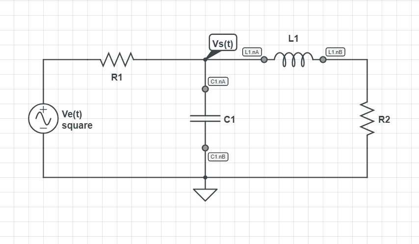
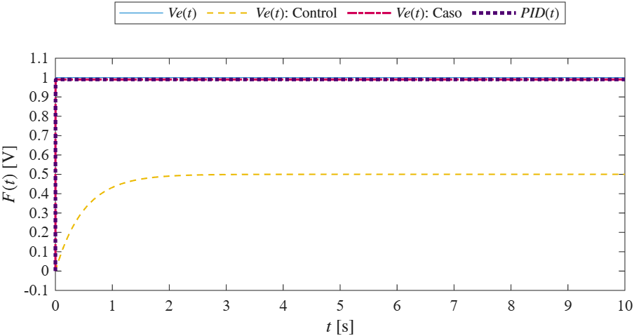
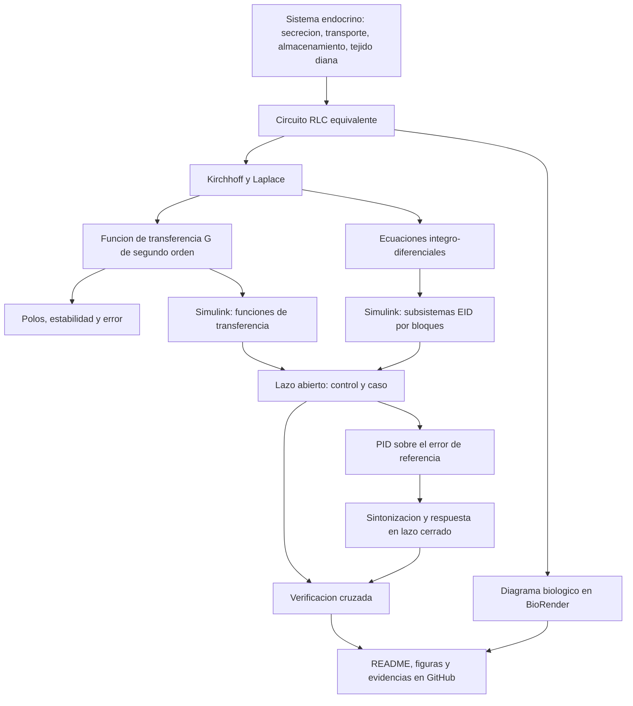

Practica 4: Modelado y control del sistema endocrino
[](https://matlab.mathworks.com/open/github/v1?repo=Nefga/MSFP4)
# Práctica Cuatro: Modelado y control del sistema endocrino

## Información del estudiante
Neltzon Farid Garcia Altamirano\[23212194]; l23212194@tijuana.tecnm.mx

Modelado de Sistemas Fisiológicos

Ingeniería Biomédica

## Docente
Dr. Paul Antonio Valle Trujillo; paul.valle@tectijuana.edu.mx

Departamento de Ingeniería Eléctrica y Electrónica, Tecnológico Nacional de México/IT Tijuana, Blvd. Alberto Limón Padilla s/n, Tijuana, C.P. 22454, B.C., México.

Repositorio de la asignatura: https://github.com/DrPaulValle/MSF-IBF1020

## Descripción de la asignatura

El modelizado de sistemas fisiológicos es una herramienta importante en Ingeniería Biomédica, permite comprender el funcionamiento del cuerpo humano, así como diseñar y evaluar terapias y dispositivos médicos; se define como el proceso de formular modelos matemáticos o computacionales que representan el comportamiento y la interacción de los sistemas biológicos y fisiológicos. Esta asignatura pretende aportar al perfil del Ingeniero Biomédico la capacidad de realizar investigación científica en el área de Biología de Sistemas con la finalidad de dirigir y participar en equipos de trabajo interdisciplinarios en contextos nacionales e internacionales, así como de proporcionar soluciones informáticas para resolver problemas en el campo de la Ingeniería Biomédica con ética profesional; lo anterior al proporcionar al estudiante bases sólidas para modelizar sistemas y diseñar controladores para la solución de problemas en las áreas de atención médica y del sector industrial médico. La construcción de analogías entre circuitos eléctricos y sistemas fisiológicos para la formulación de modelos matemáticos y el diseño de controladores mediante la experimentación in silico brindan herramientas de gran aplicación en el quehacer profesional del Ingeniero Biomédico.

La asignatura de Modelado de Sistemas Fisiológicos forma parte del plan de estudios de la carrera en Ingeniería Biomédica con la siguiente competencia general del curso: Utiliza las propiedades de los circuitos RLC para describir la dinámica de sistemas fisiológicos, obtener modelos matemáticos y aplicar el control clásico, esto con el objetivo de integrar los principios de la Ingeniería de Control, la Electrónica Analógica y las Ciencias de la Computación con la Anatomía y Fisiología del cuerpo humano para proporcionar descripciones cuantitativas y cualitativas de sistemas fisiológicos complejos con el objetivo de modelizar, analizar, controlar, ilustrar y predecir su dinámica tanto en el corto como en el largo plazo.

## Objetivos

1. Calcular la función de transferencia.
2. Determinar el modelo de ecuaciones integro-diferenciales.
3. Establecer el sistema de ecuaciones diferenciales ordinarias lineales de primer orden.
4. Emular la respuesta del circuito RLC en Simulink/Simscape al escalón, impulso, rampa y función sinusoidal.
5. Simular la respuesta de los modelos matemáticos en Simulink/MATLAB al escalón, impulso, rampa y función sinusoidal.
6. Sintonizar las ganancias de un controlador PID para eliminar el error entre la entrada y la salida del sistema.
7. Obtener la respuesta en lazo abierto y en lazo cerrado con el controlador PID en Python con la función de transferencia.

## Descripción detallada del sistema

Un circuito RLC representa un sistema de segundo orden que modeliza, de manera simplificada, la dinámica de la señal hormonal en un compartimento del sistema endocrino: La fuente Ve(t) representa la secreción hormonal y el resistor R1 la oposición efectiva al transporte hormonal. El capacitor C representa el almacenamiento temporal de la señal hormonal en un compartimento antes de ser utilizada o eliminada. La rama formada por el inductor L en serie con el resistor R2 representa el retardo y la oposición de la respuesta del tejido diana. Los flujos Fe(t) y Fs(t) representan respectivamente el flujo de secreción y transporte, y el flujo de utilización o respuesta del órgano diana. El objetivo del modelo eléctrico es predecir la respuesta dinámica del nivel hormonal efectivo Vs(t), medido en el nodo de unión entre R1, C y L, a diferentes formas de onda de la señal de secreción Ve(t). Se comparan una condición de referencia (control) y una condición alterada (caso), esta última con C = 1000 µF y R2 = 1 kΩ en lugar de C = 1 µF y R2 = 100 kΩ.

La práctica se desarrolla exclusivamente mediante experimentación *in silico*; la estrategia de control tiene propósitos académicos y de simulación, y no constituye una estrategia terapéutica.

---

<a id="contenido"></a>
## Contenido

1. [Resumen](#resumen)
2. [Competencia y objetivos](#objetivos)
3. [Relación con el temario](#temario)
4. [Modelo físico y analogía eléctrica](#analogia)
5. [Formulación matemática](#modelo)
6. [Análisis temporal y de estabilidad](#analisis)
7. [Señales de entrada y condiciones de simulación](#senales)
8. [Implementación en MATLAB y Simulink](#matlab)
9. [Control en lazo cerrado y sintonización PID](#pid)
10. [Resultados y verificación cruzada](#resultados)
11. [Flujo de trabajo](#flujo)
12. [Actividades del estudiante](#actividades)
13. [Estructura del repositorio](#estructura)
14. [Requisitos](#requisitos)
15. [Reproducibilidad y entregables](#reproducibilidad)
16. [Referencias](#referencias)

---

<a id="resumen"></a>
## Resumen

La práctica tiene como propósito **modelar, analizar, simular y controlar** la señal hormonal de un compartimento endocrino a partir de un circuito eléctrico equivalente. La entrada $V_e(t)$ representa la secreción hormonal, la resistencia $R_1$ la oposición al transporte, la capacitancia $C$ el almacenamiento temporal, y la rama serie $L$–$R_2$ la respuesta retardada del tejido diana. La salida $V_s(t)$ es el nivel hormonal efectivo y normalizado disponible para producir una respuesta. Al tener dos elementos independientes que almacenan energía ($C$ y $L$), el sistema es de **segundo orden**:

$$
\boxed{G(s)=\frac{V_s(s)}{V_e(s)}=\frac{L\,s+R_2}{R_1\,L\,C\,s^{2}+\left(L+R_1R_2C\right)s+\left(R_1+R_2\right)}.}
$$

La condición **caso** se obtiene modificando dos componentes respecto del control: $C$ pasa de $1\,\mu\mathrm{F}$ a $1000\,\mu\mathrm{F}$ y $R_2$ de $100\,\mathrm{k}\Omega$ a $1\,\mathrm{k}\Omega$. El valor final baja de $0.990$ a $0.5$ y la respuesta se vuelve unas 500 veces más lenta (constante de tiempo dominante de $\approx1\,\mathrm{ms}$ a $0.5\,\mathrm{s}$).

Se estudian el error en estado estacionario y la estabilidad a través de los polos de cada modelo. Posteriormente se aplica un escalón unitario y se contrastan las funciones de transferencia y un modelo de ecuaciones integro-diferenciales (EID) implementado por bloques en Simulink. Se incorpora un **controlador PID** cuya señal de error es la diferencia entre la respuesta del control (referencia) y la salida del lazo, con ganancias sintonizadas con la herramienta *Tune* de Simulink.

La práctica se desarrolla **exclusivamente mediante experimentación *in silico***. La estrategia de control tiene propósitos académicos y de simulación, y no constituye una estrategia terapéutica.

**Palabras clave:** sistema endocrino; señal hormonal; circuito RLC; función de transferencia; segundo orden; controlador PID; MATLAB; Simulink; simulación *in silico*.

[Volver al contenido](#contenido)

---

<a id="objetivos"></a>
## Competencia y objetivos

### Competencia a desarrollar

Modelizar sistemas fisiológicos mediante analogías entre sistemas físicos, ecuaciones diferenciales y funciones de transferencia para analizar su comportamiento dinámico, y diseñar estrategias de control mediante técnicas de control clásico. En particular, se construye el circuito eléctrico equivalente del sistema endocrino, se comparan las condiciones control y caso y se diseña una estrategia de control *in silico*.

### Objetivo general

Analizar y controlar el modelo eléctrico equivalente del sistema endocrino mediante su formulación matemática, su implementación computacional y el diseño de un controlador PID, comparando las respuestas del control, del caso y del sistema controlado.

### Objetivos específicos

- Proponer el circuito equivalente e identificar $V_e(t)$, $V_s(t)$, $R_1$, $C$, $L$, $R_2$, $F_e(t)$, $F_s(t)$, los nodos principales y la referencia.
- Obtener la función de transferencia aplicando la transformada de Laplace con condiciones iniciales nulas, para control y caso.
- Relacionar el orden del sistema con los elementos $C$ y $L$.
- Determinar el error en estado estacionario y analizar la estabilidad mediante los polos.
- Expresar el modelo como ecuación integro-diferencial e implementarlo por bloques.
- Implementar un controlador PID, sintonizar sus ganancias con *Tune* y analizar la respuesta en lazo cerrado.
- Reproducir las respuestas mediante Simulink y MATLAB.
- Elaborar un diagrama biológico que relacione los elementos del modelo con el sistema endocrino.
- Documentar la práctica en un repositorio de GitHub.

[Volver al contenido](#contenido)

---

<a id="temario"></a>
## Relación con el temario

La práctica integra contenidos correspondientes a tres unidades de la asignatura **Modelado de Sistemas Fisiológicos (IBF-1020)**:

| Unidad | Área | Contenidos aplicados |
|---|---|---|
| I | Sistemas de control retroalimentados | Diagramas de bloques, respuesta ante un escalón, análisis de error y criterios de estabilidad |
| II | Modelado matemático | Analogía eléctrica, transformada de Laplace y función de transferencia de segundo orden |
| III | Controladores | Controlador PID, diseño y sintonización de ganancias |

El enfoque combina **Ingeniería de Control, Electrónica Analógica, Ciencias de la Computación y Fisiología**, de acuerdo con la competencia general de la asignatura.

[Volver al contenido](#contenido)

---

<a id="analogia"></a>
## Modelo físico y analogía eléctrica

El circuito tiene una rama principal formada por la fuente $V_e(t)$ y el resistor $R_1$. En el nodo posterior a $R_1$ se conecta un capacitor $C$ a la referencia, en paralelo con una segunda rama formada por el inductor $L$ en serie con el resistor $R_2$. La variable $V_s(t)$ se mide en el nodo de unión entre $R_1$, $C$ y $L$.



*Circuito equivalente: fuente $V_e(t)$ (señal cuadrada), resistor $R_1$, capacitor $C_1$ a la referencia y rama en serie $L_1$–$R_2$. La salida $V_s(t)$ se mide en el nodo de unión entre $R_1$, $C_1$ y $L_1$.*

### Correspondencia entre el sistema biológico, el circuito y su interpretación

| Elemento biológico | Equivalente eléctrico | Interpretación |
|---|---|---|
| Secreción hormonal | Fuente $V_e(t)$ | Señal de entrada |
| Transporte hormonal (sangre, difusión) | Resistencia $R_1$ | Oposición efectiva al transporte |
| Compartimento de almacenamiento temporal | Capacitancia $C$ | Acumulación temporal de la señal hormonal |
| Respuesta retardada del tejido diana | Inductancia $L$ en serie con $R_2$ | Retardo y oposición de la respuesta biológica |
| Flujo de secreción y transporte | Corriente $F_e(t)$ | Flujo de entrada |
| Flujo de utilización o respuesta | Corriente $F_s(t)$ | Flujo de salida (rama $L$–$R_2$) |
| Nivel hormonal efectivo normalizado | Voltaje $V_s(t)$ | Salida |

### Diagrama biológico

<p align="center">
  
</p>

*Figura elaborada en BioRender. Cada etapa del sistema endocrino (estímulo, glándula endocrina, secreción y transporte, comportamiento hormonal y tejido diana) se relaciona con su elemento del circuito ($V_e$, $R_1$, $C$, $V_s$, $L$ y $R_2$), junto con los flujos $F_e(t)$ y $F_s(t)$ y la tabla de parámetros de control y caso.*

### Parámetros para la simulación

| Parámetro | Control | Caso | Unidad |
|---|---:|---:|---|
| $V_e(t)$ | $1$ (escalón) | $1$ (escalón) | V |
| $R_1$ | $1$ | $1$ | kΩ |
| $L$ | $100$ | $100$ | mH |
| $C$ | $1$ | $1000$ | µF |
| $R_2$ | $100$ | $1$ | kΩ |

Las diferencias entre control y caso son $C$ y $R_2$.

> **Alcance de la analogía:** los valores corresponden al circuito eléctrico equivalente empleado para la experimentación *in silico*. La analogía conserva la estructura matemática, pero no debe interpretarse como una conversión numérica directa a unidades fisiológicas.

[Volver al contenido](#contenido)

---

<a id="modelo"></a>
## Formulación matemática

### 1. Ecuaciones principales

Por la ley de corrientes en el nodo $V_s$ y las relaciones de cada elemento:

$$
F_e(t)=F_c(t)+F_s(t),
$$

$$
F_e(t)=\frac{V_e(t)-V_s(t)}{R_1},\qquad
F_c(t)=C\frac{dV_s(t)}{dt},\qquad
V_s(t)=L\frac{dF_s(t)}{dt}+R_2F_s(t).
$$

### 2. Transformada de Laplace

Con condiciones iniciales nulas:

$$
F_e(s)=\frac{V_e(s)-V_s(s)}{R_1},\qquad F_c(s)=C\,s\,V_s(s),\qquad F_s(s)=\frac{V_s(s)}{Ls+R_2}.
$$

### 3. Función de transferencia

Sustituyendo en $F_e=F_c+F_s$:

$$
\frac{V_e(s)-V_s(s)}{R_1}=C\,s\,V_s(s)+\frac{V_s(s)}{Ls+R_2}
\;\Rightarrow\;
\frac{V_e(s)}{R_1}=V_s(s)\left[\frac{1}{R_1}+C\,s+\frac{1}{Ls+R_2}\right].
$$

Llevando todo al denominador común $R_1(Ls+R_2)$:

$$
V_e(s)\,(Ls+R_2)=V_s(s)\left[(Ls+R_2)+R_1C\,s\,(Ls+R_2)+R_1\right],
$$

y expandiendo $R_1Cs(Ls+R_2)=R_1LC\,s^2+R_1R_2C\,s$:

$$
\boxed{G(s)=\frac{V_s(s)}{V_e(s)}=\frac{L\,s+R_2}{R_1LC\,s^{2}+\left(L+R_1R_2C\right)s+\left(R_1+R_2\right)}.}
$$

En $s=0$, $G(0)=R_2/(R_1+R_2)$, que es el divisor resistivo esperado (en DC, $L$ es un corto y $C$ un abierto).

Sustituyendo los valores de cada condición:

$$
G_{control}(s)=\frac{0.1\,s+10^{5}}{10^{-4}s^{2}+100.1\,s+101000},\qquad
G_{caso}(s)=\frac{0.1\,s+1000}{0.1\,s^{2}+1000.1\,s+2000}.
$$

### 4. Orden del sistema

El denominador es de grado 2 en ambas condiciones. $C$ almacena energía en su campo eléctrico (estado $V_s$) y $L$ en su campo magnético (estado $F_s$); son dos elementos independientes que almacenan energía, por lo que el sistema es de **segundo orden**. $R_1$ y $R_2$ solo disipan y no aumentan el orden. El cero en $s=-R_2/L$ aparece porque la rama $L$–$R_2$ tiene impedancia $Ls+R_2$.

### 5. Verificación por divisor de voltaje

Con $Z=(Ls+R_2)\parallel\dfrac{1}{Cs}=\dfrac{Ls+R_2}{LCs^2+R_2Cs+1}$, se cumple $G(s)=\dfrac{Z}{R_1+Z}$, que simplifica a la misma función de transferencia.

### 6. Modelo de ecuaciones integro-diferenciales

Con $V_s$ y $F_s$ como variables internas, el sistema se expresa como

$$
V_s(t)=\frac{1}{C}\int_0^t\left[F_e(\tau)-F_s(\tau)\right]d\tau,\qquad
F_e(t)=\frac{V_e(t)-V_s(t)}{R_1},\qquad
F_s(t)=\frac{1}{R_2}\left[V_s(t)-L\frac{dF_s(t)}{dt}\right].
$$

Este es el modelo que se implementa por bloques (integrador, derivador y ganancias) en los subsistemas `EID` de Simulink.

[Volver al contenido](#contenido)

---

<a id="analisis"></a>
## Análisis temporal y de estabilidad

### 1. Control y caso

Con $a=R_1LC$, $b=L+R_1R_2C$ y $c=R_1+R_2$, los polos se obtienen de $\lambda=\dfrac{-b\pm\sqrt{b^2-4ac}}{2a}$.

| Característica | Control | Caso |
|---|---:|---:|
| $a$ | $1\times10^{-4}$ | $0.1$ |
| $b$ | $100.1$ | $1000.1$ |
| $c$ | $101\,000$ | $2000$ |
| $b^2-4ac$ | $9979.61$ | $999\,400.01$ |
| Polos | $-1010$ y $-999\,990$ | $-2.0$ y $-9999$ |
| Cero | $-10^{6}$ | $-10^{4}$ |
| $G(0)=R_2/(R_1+R_2)$ | $0.9901$ | $0.5$ |
| Constante de tiempo dominante | $\approx0.99\,\mathrm{ms}$ | $\approx0.5\,\mathrm{s}$ |

En ambos casos $b^2-4ac>0$: las raíces son reales, distintas y negativas, por lo que las respuestas son **estables y sobreamortiguadas**. El polo rápido queda casi sobre el cero, así que prácticamente se cancelan y la respuesta se comporta como la de un sistema de primer orden:

$$
G_{control}(s)\approx\frac{1000}{s+1010},\qquad G_{caso}(s)\approx\frac{1}{s+2}.
$$

### 2. Error en estado estacionario

Para una entrada escalón unitario $V_e(s)=1/s$, se tiene $V_s(s)=G(s)/s$. Como los polos de ambos sistemas son negativos, se puede aplicar el teorema del valor final:

$$
V_s(\infty)=\lim_{s\to0}s\,\frac{G(s)}{s}=G(0)=\frac{R_2}{R_1+R_2},
$$

$$
\boxed{e_{ss}=1-G(0)=\frac{R_1}{R_1+R_2}.}
$$

| | $V_s(\infty)$ | $e_{ss}$ |
|---|---:|---:|
| Control | $0.9901\ \mathrm{V}$ | $0.0099\ \mathrm{V}$ |
| Caso | $0.5\ \mathrm{V}$ | $0.5\ \mathrm{V}$ |

El valor final depende únicamente de $R_1$ y $R_2$: $C$ y $L$ solo determinan la rapidez del transitorio. La diferencia entre las dos condiciones en estado estacionario es $0.9901-0.5=0.4901\ \mathrm{V}$.

### 3. Predicción previa

Ante un escalón de $1\,\mathrm{V}$ se espera:

- una curva monótona creciente, sin oscilaciones ni sobreimpulso;
- el control llegando a $\approx0.99\,\mathrm{V}$ en unos $5\,\mathrm{ms}$;
- el caso creciendo con constante de tiempo $\approx0.5\,\mathrm{s}$ y estabilizándose en $0.5\,\mathrm{V}$ en unos $2.5\,\mathrm{s}$.

#### Ejemplo mínimo de verificación en MATLAB

```matlab
R1 = 1e3; L = 100e-3;

C = 1e-6; R2 = 100e3;
Gcontrol = tf([L, R2], [R1*L*C, L+R1*R2*C, R1+R2]);
polos_control = pole(Gcontrol)

C = 1000e-6; R2 = 1e3;
Gcaso = tf([L, R2], [R1*L*C, L+R1*R2*C, R1+R2]);
polos_caso = pole(Gcaso)
```

[Volver al contenido](#contenido)

---

<a id="senales"></a>
## Señales de entrada y condiciones de simulación

El intervalo de simulación es $0\le t\le10\,\mathrm{s}$. Se establece un **paso máximo** de $\Delta t=10^{-3}\,\mathrm{s}$ y el solver `ode15s` en Simulink.

| Señal | Definición para la simulación | Propósito |
|---|---|---|
| Escalón | Amplitud $1\,\mathrm{V}$, inicio en $t=0$ | Examinar la respuesta ante una secreción hormonal sostenida |

La misma señal se aplica al control, al caso y al sistema con controlador, con condiciones iniciales nulas, para que las respuestas sean comparables.

[Volver al contenido](#contenido)

---

<a id="matlab"></a>
## Implementación en MATLAB y Simulink

El modelo de Simulink (`MPSFP4NFGA.slx`) contiene los siguientes elementos:

| Elemento | Bloque | Descripción |
|---|---|---|
| Entrada | `Step` (`Ve(t)`) | Escalón de $1\,\mathrm{V}$ en $t=0$ |
| Control | Subsistema `Control` | Función de transferencia $G_{control}(s)$ y subsistema `EID` con $R_1=1\,\mathrm{k}\Omega$, $L=100\,\mathrm{mH}$, $C=1\,\mu\mathrm{F}$, $R_2=100\,\mathrm{k}\Omega$ |
| Caso | Subsistema `Sistema:Caso` | Función de transferencia $G_{caso}(s)$ y subsistema `EID: Caso` con $C=1000\,\mu\mathrm{F}$ y $R_2=1\,\mathrm{k}\Omega$ |
| Lazo con PID | `Sum`, `PID Controller` y función de transferencia dentro de `Sistema:Caso` | El `Sum` calcula $e(t)=x_{control}(t)-x_{lazo}(t)$ y el PID genera la señal de control |
| Registro de señales | `To Workspace` | Variables `Ve` (entrada), `Gcon` (control), `Gcas` (caso en lazo abierto) y `PID` (salida con controlador) |

Las funciones de transferencia se escriben con los coeficientes de la sección [Formulación matemática](#modelo):

| Condición | Numerador | Denominador |
|---|---|---|
| Control | `[0.1, 100000]` | `[1e-4, 100.1, 101000]` |
| Caso | `[0.1, 1000]` | `[0.1, 1000.1, 2000]` |

Los subsistemas `EID` implementan las ecuaciones integro-diferenciales de la sección 6 con ganancias $1/R_1$, $1/R_2$, $1/C$, un integrador y un derivador.

### Ejecución desde el cuaderno MATLAB

El cuaderno (`.mlx`) ejecuta el modelo de Simulink, recupera las señales en el *Workspace* y las grafica con la función `plotsignals`.

#### Datos de la simulación

```matlab
clc; clear; close all; warning('off','all')
open_system('MPSFP4NFGA.slx')
parameters.StopTime = '10';
parameters.Solver = 'ode15s';
parameters.MaxStep ='1e-3';
```

#### Respuesta al escalón

```matlab
X = sim('MPSFP4NFGA.slx',parameters);
plotsignals(X.t,X.Ve,X.Gcas,X.Gcon,X.PID,'Control y caso')
```

#### Función de graficación

```matlab
function plotsignals(t,Ve,Gcas,Gcon,PID,signal)
set(figure(),'color','w')
set(gcf,'units','inches','position',[1,1,7,3.5])
set(gca,'fontname','times new roman','fontsize',11)
hold on; grid off; box on;
ctrl1 = [0, 125, 204]/255;
ctrl2 = [235,185,0]/255;
ctrl3 = [209,0,86]/255;
ctrl4 = [80,0,113]/255;
order = [ctrl1;ctrl2;ctrl3;ctrl4]; colororder(order)

if signal == "Control y caso"
    plot(t,Ve,'-','Linewidth',0.5,'Color',ctrl1)
    plot(t,Gcas,'--','Linewidth',1,'Color',ctrl2)
    plot(t,Gcon,'-.','Linewidth',1.5,'Color',ctrl3)
    plot(t,PID,':','Linewidth',2.5,'Color',ctrl4)
    L = legend('$V_e(t)$','$V_s(t)$: Caso','$V_s(t)$: Control','$PID(t)$');
end

set(L,'interpreter','latex','location','northoutside','orientation','horizontal')

xlabel('$t$ [s]','interpreter','latex')
ylabel('$V(t)$ [V]','interpreter','latex')
xlim([0 10]); xticks(0:1:15)
ylim([-0.1 1.1]); yticks(-0.1:0.1:1.1)
exportgraphics(gcf,[signal,'.matlab.pdf'],'contenttype','vector')
end
```

La función grafica la entrada, el caso, el control y la respuesta con PID, identifica las variables y sus unidades, y guarda la figura en PDF vectorial.

[Volver al contenido](#contenido)

---

<a id="pid"></a>
## Control en lazo cerrado y sintonización PID

### 1. Retroalimentación negativa

La respuesta de la condición control se utiliza como **referencia**. El controlador PID actúa sobre la señal de error

$$
e(t)=x_{control}(t)-x_{lazo}(t),
$$

con ley de control

$$
u(t)=k_Pe(t)+k_I\int_0^t e(\tau)\,d\tau+k_D\frac{de(t)}{dt},
\qquad
K(s)=k_P+\frac{k_I}{s}+\frac{k_D\,N\,s}{s+N}.
$$

Con retroalimentación negativa unitaria, la salida del lazo es

$$
x_{lazo}(s)=\frac{K(s)G_p(s)}{1+K(s)G_p(s)}\,x_{control}(s)=T(s)\,x_{control}(s),
$$

donde $G_p(s)$ es la función de transferencia del bloque de planta dentro del lazo.


### 2. Sintonización

Se utiliza la opción **Tune** del bloque `PID Controller` de Simulink (forma paralela, tiempo continuo). Las ganancias obtenidas son:

| Ganancia | Valor |
|---|---:|
| $k_P$ | $9.36225$ |
| $k_I$ | $30\,810.65$ |
| $k_D$ | $2.8504\times10^{-4}$ |
| $N$ (filtro derivativo) | $12\,954.47$ |

### 3. Función de transferencia del lazo

Con $G_p(s)=G_{control}(s)$ (bloque presente en el modelo), el lazo cerrado $T(s)$ tiene:

| Característica | Valor |
|---|---|
| Polos | $-999\,990$, $-19\,646$ y $-3687\pm2593j$ |
| Ceros | $-10^{6}$, $-7658$ y $-3992$ |
| Ganancia en estado estacionario $T(0)$ | $1$ |

- $T(0)=1$: gracias a la acción integral, la salida alcanza sin error el valor de la referencia ante una entrada constante.
- Todos los polos tienen parte real negativa, por lo que el sistema controlado es estable.
- El par complejo conjugado indica un transitorio ligeramente subamortiguado, de duración del orden de milisegundos.

[Volver al contenido](#contenido)

---

<a id="resultados"></a>
## Resultados y verificación cruzada

Las respuestas permiten contrastar **entrada, control, caso en lazo abierto y salida con controlador**. La convención gráfica de `plotsignals` es:

- **Azul:** entrada aplicada, $V_e(t)$.
- **Amarillo discontinuo:** respuesta del caso en lazo abierto, $V_s(t)$.
- **Rojo/magenta punto-raya:** respuesta del control, $V_s(t)$.
- **Morado punteado:** respuesta con PID.



### Respuesta en lazo abierto ante el escalón de 1 V

| Instante | Control | Caso |
|---|---:|---:|
| $t=1\,\mathrm{ms}$ | $\approx0.63\ \mathrm{V}$ | $\approx0.001\ \mathrm{V}$ |
| $t=10\,\mathrm{ms}$ | $\approx0.990\ \mathrm{V}$ | $\approx0.010\ \mathrm{V}$ |
| $t=1\,\mathrm{s}$ | $0.9901\ \mathrm{V}$ | $\approx0.43\ \mathrm{V}$ |
| Valor final | $0.9901\ \mathrm{V}$ | $0.5\ \mathrm{V}$ |
| Tiempo al 98 % del valor final | $\approx4\ \mathrm{ms}$ | $\approx1.96\ \mathrm{s}$ |

### Efecto del controlador

| Métrica | Caso en lazo abierto | Salida con PID |
|---|---:|---:|
| Valor final | $0.5\ \mathrm{V}$ | $0.9901\ \mathrm{V}$ |
| Error máximo respecto al control | $0.98\ \mathrm{V}$ | $0.064\ \mathrm{V}$ |
| Integral del error cuadrático $\int e^2\,dt$ | $2.71$ | $1.5\times10^{-6}$ |

La salida con PID sigue prácticamente la misma curva que el control: el único error apreciable ocurre en los primeros milisegundos.

### Archivos de resultados

| Representación | Archivo |
|---|---|
| Respuesta al escalón (control, caso y PID) | [`Control_y_caso_matlab.pdf`](Control_y_caso_matlab.pdf) |
| Cuaderno exportado | [`Garcia23212194MSPF4.pdf`](Garcia23212194MSPF4.pdf) |

### Discusión

- **Efecto de $C$ y $R_2$.** El aumento de $C$ de $1\,\mu\mathrm{F}$ a $1000\,\mu\mathrm{F}$ vuelve la respuesta unas 500 veces más lenta, y la disminución de $R_2$ de $100\,\mathrm{k}\Omega$ a $1\,\mathrm{k}\Omega$ reduce el valor final de $0.990$ a $0.5$.
- **Orden del sistema.** Ambos modelos son de segundo orden por la presencia de $C$ y $L$, pero el polo rápido se cancela con el cero y la respuesta es prácticamente de primer orden.
- **Estabilidad.** Todos los polos son reales y negativos en lazo abierto; ninguna condición es oscilatoria.
- **Error.** El error en estado estacionario depende solo de $R_1$ y $R_2$; la acción integral del PID lo lleva a cero respecto de la referencia.
- **Alcance.** El controlador se diseñó con fines académicos y de simulación; no constituye una estrategia terapéutica.

[Volver al contenido](#contenido)

---

<a id="flujo"></a>
## Flujo de trabajo



El procedimiento integra la formulación analítica y la experimentación *in silico* con una verificación cruzada entre las representaciones del modelo.

[Volver al contenido](#contenido)

---

<a id="actividades"></a>
## Actividades del estudiante

La práctica sigue una secuencia de **modelado, simulación, control y documentación**, desarrollada exclusivamente *in silico*.

### Etapa 1. Formulación y análisis

- [x] Proponer el circuito equivalente con $V_e$, $V_s$, $R_1$, $C$, $L$, $R_2$, $F_e$, $F_s$, nodos y referencia.
- [x] Obtener $G(s)$ para el control y el caso con Laplace.
- [x] Analizar el orden del sistema y relacionarlo con $C$ y $L$.
- [x] Calcular el error en estado estacionario.
- [x] Calcular los polos y analizar la estabilidad.
- [x] Expresar el modelo como ecuación integro-diferencial.

### Etapa 2. Simulación del sistema

- [x] Implementar las funciones de transferencia del control y del caso en Simulink.
- [x] Implementar los subsistemas EID por bloques.
- [x] Obtener la respuesta en lazo abierto del control y del caso.

### Etapa 3. Diseño y comprobación del controlador

- [x] Construir el sistema de retroalimentación con PID.
- [x] Sintonizar y registrar $k_P$, $k_I$, $k_D$ y $N$.
- [x] Analizar la respuesta en lazo cerrado.
- [x] Desarrollar el cuaderno de MATLAB y la función de graficación con exportación a PDF.

### Etapa 4. Diagrama biológico y documentación

- [x] Elaborar el diagrama biológico en BioRender.
- [x] Relacionar cada elemento del diagrama con el circuito.
- [x] Documentar la práctica en este README.

[Volver al contenido](#contenido)

---

<a id="estructura"></a>
## Estructura del repositorio

```text
.
├── README.md                       # Reporte de la práctica
├── MPSFP4NFGA.slx                  # Modelo Simulink
├── Garcia23212194MSPF4.mlx         # Cuaderno de MATLAB
├── Garcia23212194MSPF4.pdf         # Cuaderno exportado
├── Control_y_caso_matlab.pdf       # Figura de la respuesta al escalón
├── circuito_endocrino.png          # Circuito eléctrico equivalente
└── Sistema_endocrino_Biorender.png # Diagrama biológico (BioRender)
```

[Volver al contenido](#contenido)

---

<a id="requisitos"></a>
## Requisitos

- **MATLAB** y **Simulink**, con el modelo `MPSFP4NFGA.slx` y el cuaderno de la práctica.
- Herramientas de Simulink para la sintonización del bloque **PID Controller**.
- **Control System Toolbox**, para el ejemplo de verificación que utiliza `tf` y `pole`.

[Volver al contenido](#contenido)

---

<a id="reproducibilidad"></a>
## Reproducibilidad y entregables

### Secuencia de reproducción

1. Consultar el [repositorio general de la asignatura](https://github.com/DrPaulValle/MSF-IBF1020) y descargar los archivos proporcionados para la práctica.
2. Verificar los valores de $R_1$, $L$, $C$ y $R_2$ de cada condición.
3. Abrir `MPSFP4NFGA.slx` y comprobar los parámetros de las funciones de transferencia, del escalón y del bloque `PID Controller`.
4. Ejecutar el cuaderno de MATLAB para simular el modelo y exportar la figura en PDF.
5. Comparar las respuestas del control, del caso y de la salida con PID.

### Entregables

| Entregable | Evidencia |
|---|---|
| Circuito equivalente | Diagrama con $V_e$, $V_s$, $R_1$, $C$, $L$, $R_2$, $F_e$, $F_s$, nodos y referencia |
| Análisis matemático | Laplace, función de transferencia, orden, polos y error |
| Simulación | Modelo `MPSFP4NFGA.slx` y respuestas en lazo abierto y cerrado |
| Sintonización | Ganancias $k_P$, $k_I$, $k_D$ y $N$ |
| MATLAB | Cuaderno `.mlx` y figura `Control_y_caso_matlab.pdf` |
| Diagrama biológico | `Sistema_endocrino_Biorender.png` |
| Documentación | `README.md` |

[Volver al contenido](#contenido)

---

<a id="referencias"></a>
## Referencias

[1] M. C. Khoo, *Physiological Control Systems: Analysis, Simulation, and Estimation*, 2nd ed., IEEE Press, 2018.

[2] F. C. Hoppensteadt y C. S. Peskin, *Modeling and Simulation in Medicine and the Life Sciences*, Springer.

[3] J. E. Hall, *Guyton and Hall Textbook of Medical Physiology*, 14th ed., Elsevier, 2021.

[4] K. Ogata, *Ingeniería de Control Moderna*, 5.ª ed., Pearson Educación, 2010.

[5] N. S. Nise, *Control Systems Engineering*, 8th ed., John Wiley & Sons, 2020.

[6] P. A. Valle, *Syllabus para Modelado de Sistemas Fisiológicos*, Tecnológico Nacional de México / Instituto Tecnológico de Tijuana, Tijuana, B. C., México, 2026. Disponible en: https://biomath.xyz/course/

[7] Tecnológico Nacional de México, *Programa de estudio de la asignatura Modelado de Sistemas Fisiológicos, IBF-1020*.

---

## Uso académico

Este repositorio se utiliza como evidencia de la práctica **Modelado y control del sistema endocrino** de la asignatura Modelado de Sistemas Fisiológicos. El procedimiento se fundamenta en los materiales proporcionados por la asignatura. Su finalidad es desarrollar habilidades de modelado, simulación, control y documentación técnica; la estrategia de control tiene propósitos exclusivamente académicos y de simulación.
